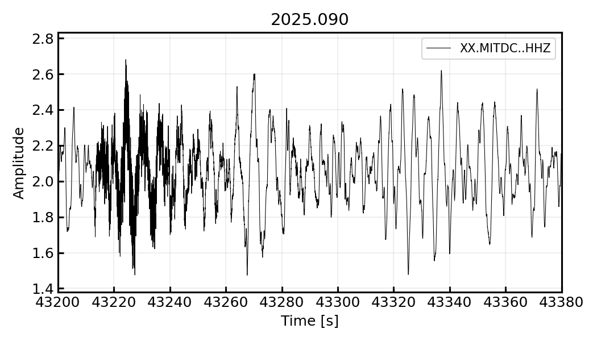
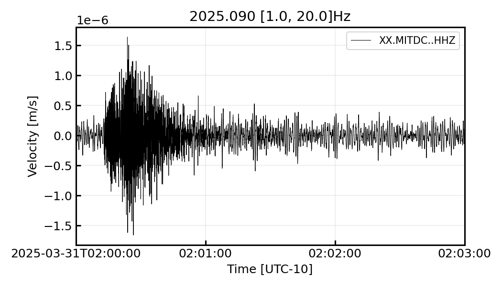
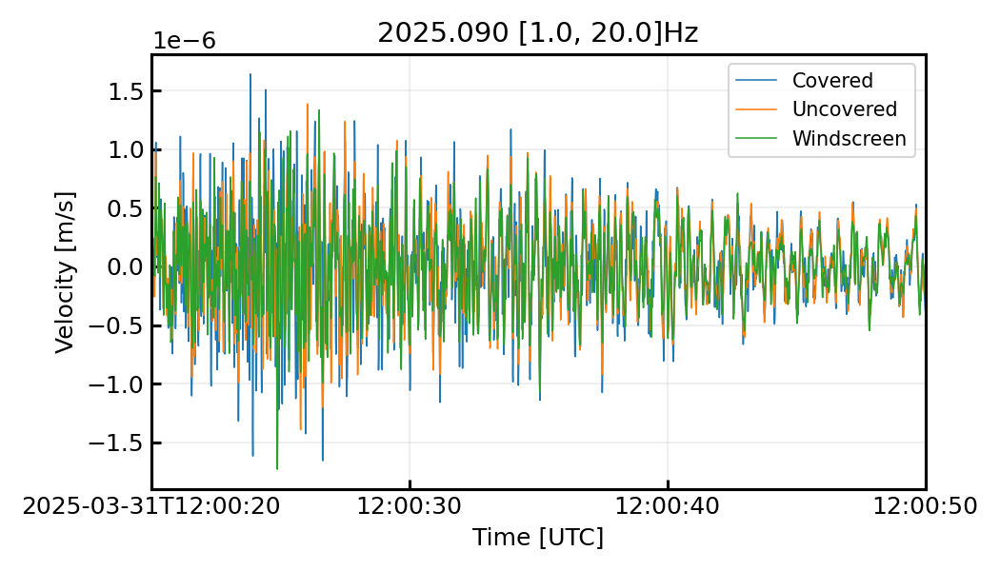
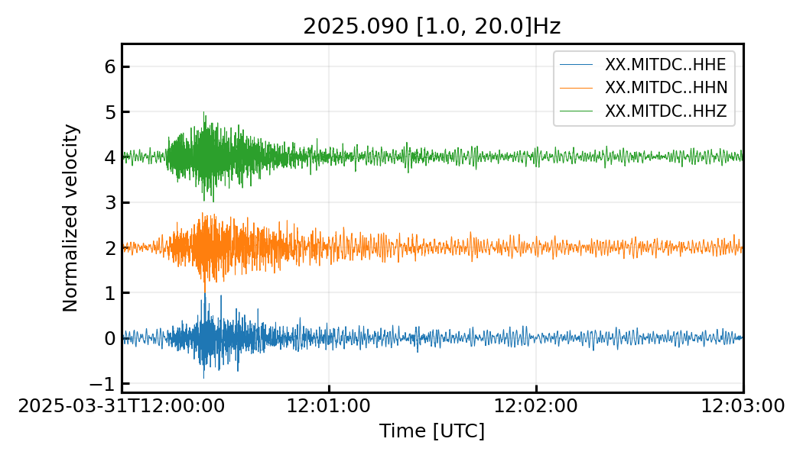
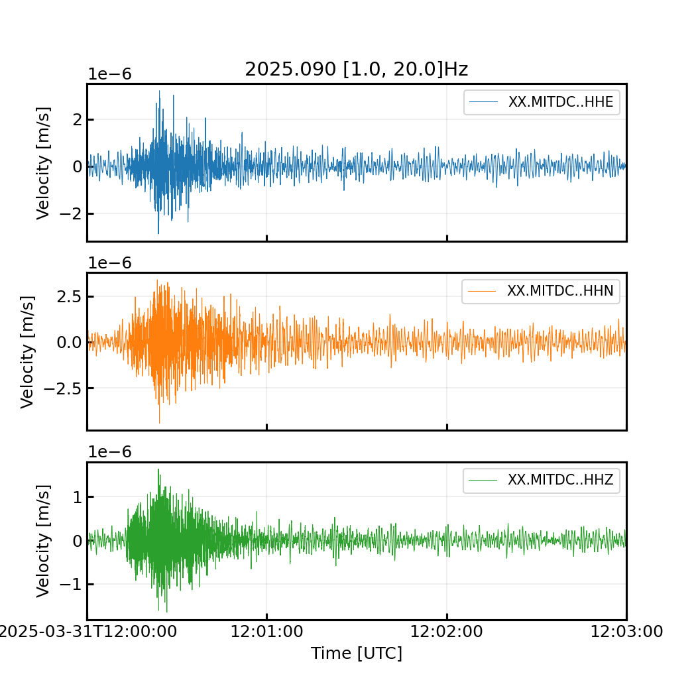
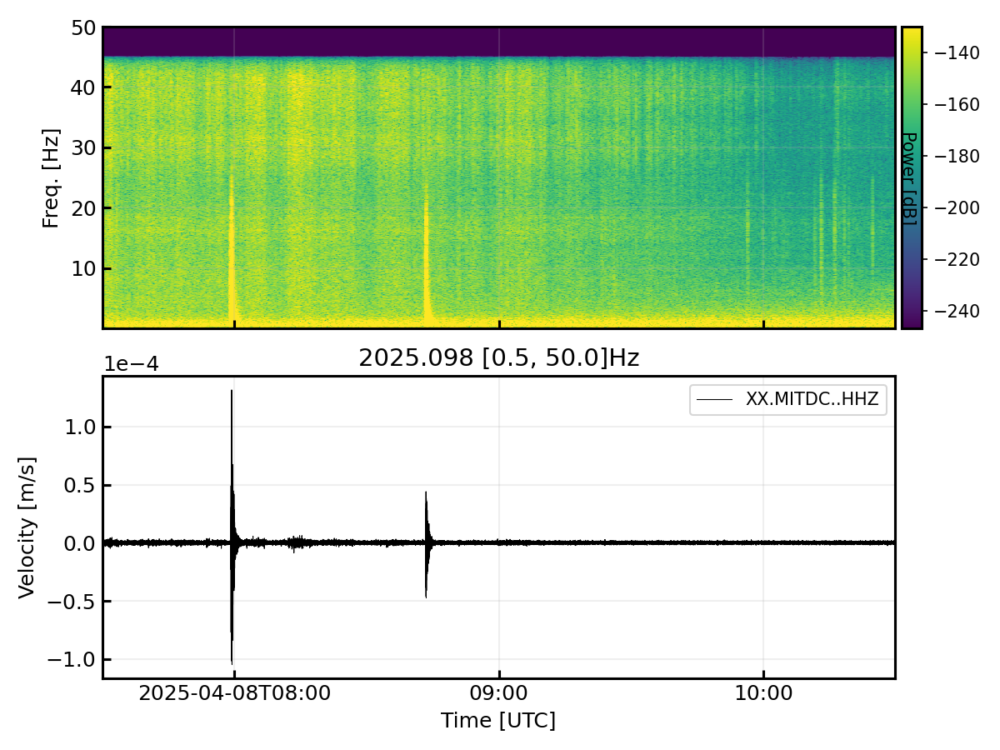
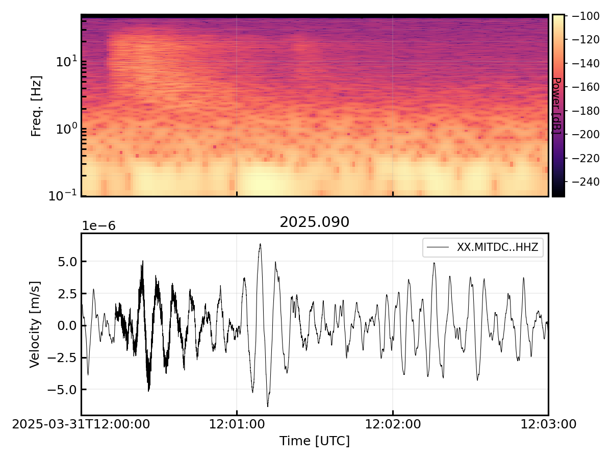
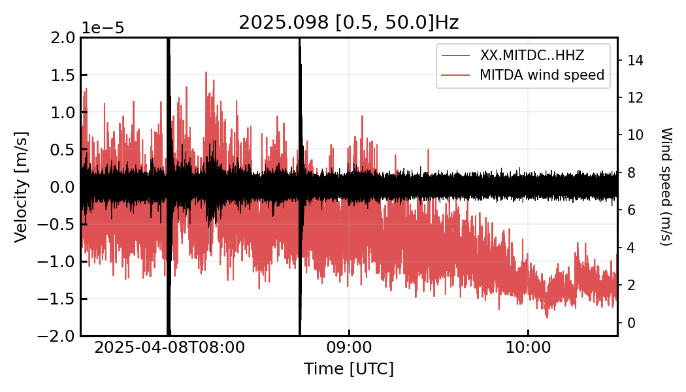
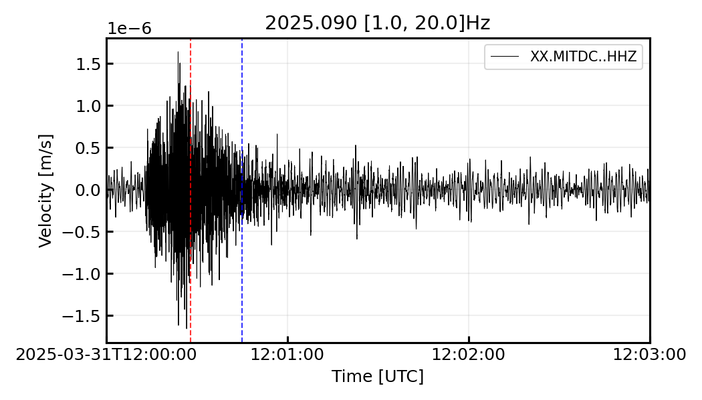
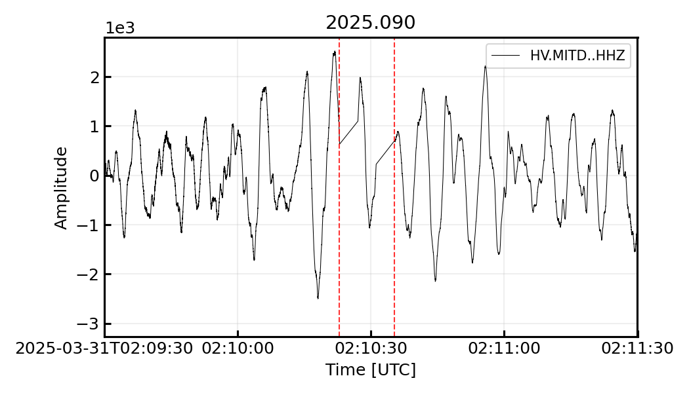

# PrettyPlot: waveform plotting

PrettyPlot (`pplot`) is a command line and Python tool for quickly making
clean figures of seismic waveforms. It was primarily developed as a fast way to visualize individual waveforms and has grown to include many other options. In one command it can:

- **READ:** read any file ObsPy can read (MiniSEED, SAC, ...) as well SPECFEM ASCII synthetics, merging gappy files or consecutive day files
- **PROCESS:** remove the instrument response using StationXML, detrend, taper, filter, integrate, differentiate and resample
- **STACK:** plot one or many waveforms, overlain, as a record section, or as a grid
- **SPECTRA:** add a spectrogram above the waveform on a shared time axis with options to modify the spectrogram characersitics to enhance signals of interest
- **COMPARE:** overlay other time series (e.g. wind speed, river gauge height) with a shared x-axis and a second y-axis
- **MARK:** mark times, TauP phase arrivals and group-velocity arrivals
- **TIME:** use relative time (s, min, h) or absolute time, quickly shift from UTC to local time

Every figure below was made with the commands shown, using data from temporary seismic deployment. Example data are not currently available:

```{note}
See the {py:class}`PrettyPlot class API documentation <pysep.pplot.PrettyPlot>`
for every input parameter.
```

## Installation

PrettyPlot is part of PySEP, so installing PySEP (see the
[installation instructions](index.rst)) also installs the `pplot` command.
Check that it works by printing the help message:

```bash
pplot -h
```

## Quick start

```bash
# Plot a file and show it on screen
pplot XX.MITDC..HHZ.2025.090

# Remove the response, bandpass 1-20 Hz, zoom in, add a spectrogram, save
pplot XX.MITDC..HHZ.2025.090 --inv ISHTAR.xml \
    --rr_pre_filt 0.05 0.1 40 45 --fmin 1 --fmax 20 --time a \
    --xlim 2025-03-31T12:00:00 2025-03-31T12:03:00 \
    --spectrogram --save event.png
```

Add `--noshow` to only save the figure without opening a window.

## How PrettyPlot processes data

Processing always happens in this order, whatever order the options are
given in:

1. **Read** every file (`fids`). With `--merge`, traces with the same ID
   are joined and gaps filled (`--merge_fill`); otherwise one trace is
   kept per file (`--idx`).
2. **Resample** to `--resample` Hz, if given.
3. **Shift to local time**, if `--time` is `a+HH` or `a-HH`.
4. **Trim** to `--xlim`, plus a buffer on each side (`--trim_pct`, by
   default 100% of the window length). The buffer keeps filter and taper
   edge effects out of the plotted window; it is cut off by the x-axis
   limits, not removed from the data.
5. **Remove the instrument response**, if `--inv` is given.
6. **Downsample** all traces to the lowest sampling rate among them and
   trim them to the time window they all share.
7. **Detrend** (`--detrend`), **taper** (`--taper`), **integrate**
   (`--integrate`) or **differentiate** (`--differentiate`), then
   **filter** (`--fmin`, `--fmax`).
8. **Plot** waveforms, then the optional added trace, spectrogram, time
   marks, group velocities and TauP arrivals.

Because the response is removed after trimming, only the plotted window
and its buffer are deconvolved, which keeps response removal fast.

---

## Examples

All examples run from a folder containing the example data files. Each
figure was saved with `--save <name>.png --dpi 150 --noshow`, which is
left out of the commands below. 

### 1. Raw data, relative time

With no options, PrettyPlot plots raw amplitude but converts the x-axis to units of seconds. If your data already have response removed, then the y-axis will be in units of motion. `--xlim` is given in the units of `--time` (here seconds), so `43200 43380` is 12:00:00 to 12:03:00 UTC for this trace which starts at UTC midnight.

```bash
pplot XX.MITDC..HHZ.2025.090 --xlim 43200 43380
```



Use `--time m` or `--time h` for minutes or hours. `--t0` subtracts an
offset (e.g. SPECFEM's `USER_T0`) and `--tstart` adds an offset. Note that `--xlim`
always refers to the units of the axis as plotted. See below for examples using absolute time.

### 2. Response removal, filtering and local time

`--inv` removes the instrument response using one or more StationXML
files. `--rr_pre_filt` sets ObsPy's frequency-domain pre-filter, and the
output is velocity by default (`--rr_output`). The y-label switches to
physical units unless you set `--ylabel`. All corresponding response removal options are prefixed with `rr_*`.

`--time a-10` plots absolute time shifted to Hawaii Standard Time (UTC-10).
With this option, `--xlim` and `--tmarks` must now be defined in local time.
Response lookup still uses UTC, so the StationXML epochs match.

```bash
pplot XX.MITDC..HHZ.2025.090 --inv ISHTAR.xml \
    --rr_pre_filt 0.05 0.1 40 45 --fmin 1 --fmax 20 --time a-10 \
    --xlim 2025-03-31T02:00:00 2025-03-31T02:03:00
```



The time zone code must have two digits: `a-10`, `a+08`, `a-07` (not
`a-7`).

### 3. Several stations on one axis

Give several files (wildcards work) to overlay them. `--colors 'C?'` uses
Matplotlib's color cycle, and `--labels` replaces the trace IDs in the
legend. `--colors` also takes one color for every trace (`k`, `red`,
`'#d62728'`), one color per trace, or a colormap name (`viridis`) to
sample colors from.

```bash
pplot XX.MITD[CUW]..HHZ.2025.090 --inv ISHTAR.xml \
    --rr_pre_filt 0.05 0.1 40 45 --fmin 1 --fmax 20 --time a \
    --xlim 2025-03-31T12:00:20 2025-03-31T12:00:50 --colors 'C?' \
    --labels Covered Uncovered Windscreen --linewidth 0.75
```



Traces are plotted in the order the files are given; a shell wildcard
sorts them alphabetically. Use `--wf_order 2 0 1` to reorder by index.

### 4. Record section

`--wf_type recsec` offsets each trace vertically. `--wf_norm` normalizes
each trace by its absolute maximum, and `--wf_recsec_spacing 2` with
`--wf_spacing_exact` puts the traces 2 units apart. Without
`--wf_spacing_exact`, the spacing is that number times the order of
magnitude of the first trace's amplitude.

```bash
pplot XX.MITDC..HH?.2025.090 --inv ISHTAR.xml \
    --rr_pre_filt 0.05 0.1 40 45 --fmin 1 --fmax 20 --time a \
    --xlim 2025-03-31T12:00:00 2025-03-31T12:03:00 \
    --wf_type recsec --wf_norm --wf_spacing_exact --wf_recsec_spacing 2 \
    --colors C0 C1 C2 --ylim -1.2 6.5 --ylabel "Normalized velocity"
```



`--wf_type stack` overlays all traces and adds their stack (the mean of
the absolute values, a simple envelope) as an extra trace;
`--wf_type recsec_stack` does the same as a record section.

### 5. Grid of subplots

`--wf_type grid` gives each file its own subplot, with a shared time axis
and separate y-axes. By default there is one column; set the layout with
`--wf_grid NROWS NCOLS` (or `--nrows` and `--ncols`). Each subplot uses its own natural y-limits, or
pass `--ylim_grid ymin1 ymax1 ymin2 ymax2 ...` to set each one.

```bash
pplot XX.MITDC..HH?.2025.090 --inv ISHTAR.xml \
    --rr_pre_filt 0.05 0.1 40 45 --fmin 1 --fmax 20 --time a \
    --xlim 2025-03-31T12:00:00 2025-03-31T12:03:00 \
    --wf_type grid --colors C0 C1 C2 --fig_size 7 7
```



Grid plots cannot include a spectrogram.

### 6. Spectrogram

`--spectrogram` adds a spectrogram above the waveform, computed from the
processed data and sharing its time axis. This three-hour window shows two vertical stripes where transients (likely body wave arrivals) occur, also visible in the time series. 

```bash
pplot XX.MITDC..HHZ.2025.098 --inv ISHTAR.xml \
    --rr_pre_filt 0.05 0.1 40 45 --fmin 0.5 --time a \
    --xlim 2025-04-08T07:30:00 2025-04-08T10:30:00 \
    --spectrogram --sp_vmax -130 --sp_clip 0.5 1
```



Color scale options:

- **dB:** power is in dB by default; `--sp_dbscale_off` plots the square
  root of power instead.
- **`--sp_clip lo hi`:** clips the color range to fractions of the data
  range. For example, `0.5 1` shows only the top half, which hides the very
  low values above the pre-filter corner (45 Hz here).
- **`--sp_vmax`:** sets an absolute upper color limit in dB.

The window length is chosen automatically from the plotted time range;
see [Performance notes](#performance-notes).

### 7. Log-frequency spectrogram

`--sp_logscale` uses a log frequency axis. `--sp_wlen` sets the window
length in seconds. Longer windows resolve lower frequencies (the axis
starts at 1 / window length) but blur timing. `--sp_cmap` takes any
Matplotlib colormap. All spectrogram control parametrs start with `--sp_*`.

```bash
pplot XX.MITDC..HHZ.2025.090 --inv ISHTAR.xml \
    --rr_pre_filt 0.05 0.1 40 45 --time a \
    --xlim 2025-03-31T12:00:00 2025-03-31T12:03:00 \
    --spectrogram --sp_logscale --sp_wlen 8 --sp_cmap magma --sp_clip 0.4 1
```



No filter is applied here, so the waveform is dominated by the ~0.2 Hz
microseism, while the spectrogram shows the event at 5-30 Hz.

### 8. Overlaying another time series

`--add_trace` plots a second time series on its own y-axis, behind the
waveform. It can have any sampling rate and any ObsPy-readable format
(multiple segments are merged). Here, 1 Hz wind speed from the co-located
anemometer is shown during the window from example 6. `--ylim 2E-5`
(a single value gives symmetric limits) zooms in on the background noise.

```bash
pplot XX.MITDC..HHZ.2025.098 --inv ISHTAR.xml \
    --rr_pre_filt 0.05 0.1 40 45 --fmin 0.5 --time a \
    --xlim 2025-04-08T07:30:00 2025-04-08T10:30:00 \
    --add_trace XX.MITDA..LWS.2025.098 --tr_ylabel "Wind speed (m/s)" \
    --tr_label "MITDA wind speed" --tr_color C3 --ylim 2E-5
```



`--tr_time a` (the default) places the added trace by its own absolute
start time; use it with `--time a`. `--tr_time r` plots it in seconds
from its own start instead. The added trace is not processed: no
response removal or filtering. The trace is assumed to also be in UTC time and readable as an ObsPy readable format.

### 9. Time marks

`--tmarks` draws dashed vertical lines, in the units of `--time` (dates
for absolute time, numbers for relative time). `--tmarks_c` gives one
color for all marks, or one per mark. All tmark control parameters start with `--tmarks_*`.

```bash
pplot XX.MITDC..HHZ.2025.090 --inv ISHTAR.xml \
    --rr_pre_filt 0.05 0.1 40 45 --fmin 1 --fmax 20 --time a \
    --xlim 2025-03-31T12:00:00 2025-03-31T12:03:00 \
    --tmarks 2025-03-31T12:00:28 2025-03-31T12:00:45 --tmarks_c r b
```



### 10. Gappy files and multiple days

By default PrettyPlot keeps one trace per file (`--idx`, default 0). If
a file has gaps, that is only the first segment of the Stream, so only data up to the first gap would be plotted. `--merge` joins all traces with the same ID and fills the gaps. `--merge_fill` controls how:

- `interpolate` (default): a straight line between the samples on either
  side
- `latest`: repeat the last sample before the gap
- a number, such as `0`

The red lines mark the start and end of the gappy stretch.

```bash
pplot HV.MITD..HHZ.2025.090 --merge --time a \
    --xlim 2025-03-31T02:09:30 2025-03-31T02:11:30 \
    --tmarks 2025-03-31T02:10:22.96 2025-03-31T02:10:35.33 --tmarks_c r
```



`--merge` also joins consecutive files of one channel, so a window that
crosses midnight can be plotted from two day files:

```bash
pplot XX.MITDC..HHZ.2025.09[01] --merge --time a \
    --xlim 2025-03-31T23:58:00 2025-04-01T00:02:00
```

With `--merge`, every channel found in the files is plotted and `--idx`
is ignored. PrettyPlot prints the number of gaps and how many seconds were
filled. Filled stretches are not real data, so check that they are short
compared with the features you are interpreting.

### 11. TauP and group-velocity arrivals

For an event with a known location, PrettyPlot can mark theoretical phase
arrivals from TauP and arrivals for given group velocities. 

```bash
pplot <file> --time a \
    --xlim <origin time> <origin time + 5 min> \
    --tp_phases P S Pn Sn --tp_dist_km 120 --tp_depth 10 \
    --tp_start <origin time> --group_vels 3.5 3.0
```

- **`--tp_phases`:** TauP phase names. Each phase gets a vertical line
  colored by `--tp_cmap`, labelled once.
- **Distance and depth:** give one of `--tp_dist_km` or `--tp_dist_deg`,
  plus `--tp_depth` in km. `--tp_model` is any TauP model (default
  `iasp91`).
- **`--tp_start`:** the event origin time, in the units of `--time`. If it
  is left out, the start of `--xlim` (or the first sample) is used.
- **`--group_vels`:** marks the arrival time `distance / velocity` for
  each velocity (km/s), using the same distance and origin time.
- **`--tp_plot_rays`:** opens a separate figure of the ray paths.

For SPECFEM synthetics, `--t0` (`USER_T0`) is added to the origin time.

---

## Using PrettyPlot from Python

Every command line option is also a keyword argument of the `PrettyPlot`
class, without the leading dashes. The exceptions are the `--*_off` and
`--no*` flags, which become positive keywords: `legend=False`
(`--no_legend`), `show=False`, `sp_dbscale=False`, `rr_zero_mean=False` and
`rr_taper=False`. List options become lists.

```python
from pysep.pplot import PrettyPlot

pp = PrettyPlot(["XX.MITDC..HHZ.2025.090"], inv="ISHTAR.xml",
                rr_pre_filt=[0.05, 0.1, 40, 45], fmin=1, fmax=20,
                time="a", xlim=["2025-03-31T12:00:00",
                                "2025-03-31T12:03:00"],
                spectrogram=True, show=False, save="event.png")
pp.run()
```

`inv` also accepts an ObsPy `Inventory`, which saves re-reading the
StationXML when making many figures.

To customize the figure before saving, run the steps of `run()`
yourself. The figure is `pp.f`, the waveform axis is `pp.ax` (`pp.axs` for
grid plots) and the spectrogram axis is `pp.ax_spectra`. The processed
data are in `pp.st`.

```python
from matplotlib.dates import date2num
from obspy import UTCDateTime, read_inventory
from pysep.pplot import PrettyPlot

inv = read_inventory("ISHTAR.xml")
pp = PrettyPlot(["XX.MITDC..HHZ.2025.090"], inv=inv,
                rr_pre_filt=[0.05, 0.1, 40, 45], fmin=1, fmax=20,
                time="a", xlim=["2025-03-31T12:00:00",
                                "2025-03-31T12:03:00"],
                spectrogram=True, show=False)
pp.setup_plot()
pp.trim_waveform()
pp.remove_response()        # only if `inv` is given
pp.process_waveforms()
pp.get_plot_parameters()
pp.plot_waveforms()
pp.set_ylim()
pp.plot_spectrogram()       # only if `spectrogram=True`
pp.set_plot_aesthetics()

# Shade a time window; absolute times are Matplotlib date numbers
t0 = date2num(UTCDateTime("2025-03-31T12:00:25").datetime)
t1 = date2num(UTCDateTime("2025-03-31T12:00:45").datetime)
pp.ax.axvspan(t0, t1, color="C1", alpha=0.2, zorder=1)
pp.f.savefig("event_custom.png", dpi=150)
```

The full order of steps, including the optional ones, is in
`PrettyPlot.run()`. `PrettyPlot` can also be imported directly from
`pysep`.

The module-level functions in `pysep.pplot` can also be used on their own:

- **`fast_remove_response(tr, inventory, ...)`:** fast response removal
  for a single trace.
- **`spectrogram(ax, xvals, data, samp_rate, ...)`:** draws a spectrogram
  on any axis whose x values are `xvals`.
- **`merge_stream(st, fill)`:** merges traces with the same ID and fills
  gaps, as `--merge` does.

---

## Option reference

Short aliases are shown in brackets. Run `pplot -h` for the help text.

### Input and processing

| Option | Default | Description |
|---|---|---|
| `fids` | required | File(s) to plot; wildcards accepted. Any ObsPy-readable format, or SPECFEM two-column ASCII |
| `--merge` | off | Join traces with the same ID (gappy files, consecutive day files) and fill gaps; plots every channel found and ignores `--idx` |
| `--merge_fill` | `interpolate` | How `--merge` fills gaps: `interpolate`, `latest` or a number |
| `--idx` | 0 | Without `--merge`: if a file holds several traces, which one to keep (applies to all files) |
| `--resample` (`-r`) | none | Resample all data to this rate (Hz) before trimming |
| `--trim_pct` | 1.0 | Buffer on each side of `--xlim`, as a fraction of the window length, kept for processing but not shown |
| `--detrend` | none | `simple`, `linear` or `demean` |
| `--taper` (`-tp`) | 0 | Taper fraction; 0.05 is used automatically when integrating or differentiating |
| `--integrate` | 0 | Integrate this many times |
| `--differentiate` | 0 | Differentiate this many times |
| `--fmin` (`-f1`) | none | Highpass corner (Hz); with `--fmax`, a bandpass |
| `--fmax` (`-f2`) | none | Lowpass corner (Hz) |
| `--corners` (`-C`) | 4 | Filter corners |
| `--zerophase` (`-z`) | off | Zero-phase (two-pass) filter |
| `--t0` (`-t0`) | 0 | Subtract from relative time, e.g. SPECFEM `USER_T0` |
| `--tstart` (`-ts`) | 0 | Add to relative time |
| `--output` (`-o`) | none | Folder to write the processed traces to, as `<NET.STA.LOC.CHA>.mseed` |

### Instrument response removal

These map onto ObsPy's
[`Stream.remove_response()`](https://docs.obspy.org/packages/autogen/obspy.core.stream.Stream.remove_response.html).

| Option | Default | Description |
|---|---|---|
| `--inv` | none | StationXML file(s); response removal is skipped without it |
| `--rr_output` | `VEL` | `DISP`, `VEL`, `ACC`, or `DEF` (the response's own units) |
| `--rr_water_level` | 60 | Water level (dB); `none` turns it off |
| `--rr_pre_filt` | none | Four corner frequencies (Hz) of the frequency-domain taper, e.g. `0.05 0.1 40 45` |
| `--rr_zero_mean_off` | off | Do not demean before deconvolution |
| `--rr_taper_off` | off | Do not taper before deconvolution |
| `--rr_taper_fraction` | 0.05 | Taper fraction before deconvolution |
| `--rr_exact` | off | Use ObsPy's `remove_response()` unchanged (slower; see [Performance notes](#performance-notes)) |

### Waveform layout

| Option | Default | Description |
|---|---|---|
| `--wf_type` | `default` | `default` (overlain), `stack`, `recsec`, `recsec_stack` or `grid` |
| `--wf_norm` | off | Normalize each trace by its absolute maximum |
| `--wf_scale` | 1 | Multiply all amplitudes by this value |
| `--wf_abs` | off | Plot absolute values (plotting only) |
| `--wf_recsec_spacing` | 1 | Record section spacing: a multiplier on the first trace's order of magnitude, or exact with `--wf_spacing_exact` |
| `--wf_spacing_exact` | off | Use `--wf_recsec_spacing` as the exact spacing |
| `--wf_order` | none | Plot order as indices into the file list, e.g. `2 0 1` |
| `--wf_grid` | n files, 1 | Grid layout for `--wf_type grid`, as `NROWS NCOLS` |
| `--nrows`, `--ncols` | n files, 1 | Same as `--wf_grid`, one value each |

### Waveform style

| Option | Default | Description |
|---|---|---|
| `--colors` (`-c`) | `k` | One Matplotlib color for all traces (`k`, `red`, `'#d62728'`); one color per trace (repeated if too few); `C?` for Matplotlib's color cycle; or a colormap name (`viridis`) to sample colors from |
| `--alphas` | 1 | Opacity, one value per trace |
| `--labels` (`-l`) | trace IDs | Legend labels, one per trace |
| `--linewidth` (`-lw`) | 0.5 | Line width |
| `--ylabel` | `Amplitude` | Y-axis label; replaced by physical units after response removal unless set |
| `--ylim` (`-y`) | auto | `ymin ymax`, or one value for symmetric limits |
| `--ylim_grid` | auto | Grid plots: one `ymin ymax` pair per subplot |

### Time axis

| Option | Default | Description |
|---|---|---|
| `--time` (`-t`) | `s` | `s`, `m` or `h` for relative time; `a` for absolute UTC; `a+HH` / `a-HH` to shift to local time |
| `--xlim` (`-x`) | full trace | Time limits in the units of `--time`; dates such as `2025-03-31T12:00:00` for absolute time |
| `--minticks`, `--maxticks` | 3, 6 | Number of date ticks for absolute time |
| `--tmarks` (`-tm`) | none | Times to mark with vertical lines |
| `--tmarks_c` | `k` | Color(s) of the time marks |
| `--group_vels` | none | Group velocities (km/s) to mark; needs a TauP distance |

### TauP arrivals

| Option | Default | Description |
|---|---|---|
| `--tp_phases` | none | Phase names, e.g. `P S Pn Sn` |
| `--tp_model` | `iasp91` | TauP model |
| `--tp_dist_km` / `--tp_dist_deg` | none | Source-receiver distance |
| `--tp_depth` | none | Source depth (km) |
| `--tp_start` | `xlim[0]` | Origin time, in the units of `--time` |
| `--tp_cmap` | `rainbow_r` | Colormap for phase lines |
| `--tp_plot_rays` | off | Also plot the ray paths |

### Spectrogram

| Option | Default | Description |
|---|---|---|
| `--spectrogram` | off | Add a spectrogram above the waveform |
| `--sp_idx` | 0 | Which trace (index into the file list) to use |
| `--sp_wlen` | auto | Window length (s); see [Performance notes](#performance-notes) |
| `--sp_overlap` | 0.9 | Window overlap, 0 to 1 |
| `--sp_logscale` | off | Log frequency axis |
| `--sp_dbscale_off` | off | Plot sqrt(power) instead of dB |
| `--sp_cmap` | `viridis` | Colormap |
| `--sp_numcol` | 256 | Number of discrete colors |
| `--sp_clip` | `0 1` | Color range as fractions of the data range |
| `--sp_vmax` | none | Absolute upper color limit |

### Added time series

| Option | Default | Description |
|---|---|---|
| `--add_trace` | none | File to plot on a second y-axis |
| `--tr_time` | `a` | `a` to place it by absolute time, `r` for seconds from its start |
| `--tr_ylabel` | none | Label of the second y-axis |
| `--tr_label` | trace ID | Legend label |
| `--tr_color` | `C0` | Line color |

### Figure and output

| Option | Default | Description |
|---|---|---|
| `--fig_size` | 7 4; 8 6 with a spectrogram; 7 x 4 per subplot for grids | Figure width and height (inches) |
| `--fig_len`, `--fig_asp` | 8, none | Width and aspect ratio (height / width); used only if `--fig_asp` is given, and overrides `--fig_size` |
| `--dpi` | Matplotlib default (100) | Resolution |
| `--title` | auto | Figure title. The automatic title is the year and Julian day, the filter band and TauP details |
| `--title_append`, `--title_prepend` | none | Add to the automatic title |
| `--subplot_label` | none | Large label in the top-left corner, e.g. `a)` |
| `--no_legend` | off | Hide the legend |
| `--ncol_legend` | 1 | Legend columns |
| `--frameoff` | off | Hide axes, legend and title, leaving only the waveform |
| `--save` (`-s`) | none | Output file; `auto` names it after the first input file |
| `--transparent` | off | Transparent background |
| `--noshow` | off | Do not open a window |

Font sizes for every text element are set in the `FONTSIZES` dictionary at
the top of `pysep/pplot.py`.

---

## Performance notes

PrettyPlot is built for windows from seconds to a few hours. Two steps
used to dominate the run time, and both are now fast. A two-hour,
100 Hz window with response removal and a spectrogram takes about 2 s.

**Response removal.** ObsPy evaluates the full instrument response at
every FFT frequency, which is about a million points for an hour of
100 Hz data. PrettyPlot evaluates it at about 40,000 frequencies (evenly
spaced, plus extra points near 0 Hz) and interpolates onto the FFT grid.
Every other step is the same as ObsPy's. The result matches ObsPy to
within 1e-7 of the peak amplitude, about 4 times faster. `--rr_exact`
switches back to ObsPy. Short traces and polynomial responses always use
ObsPy.

**Spectrogram.** Only the plotted window is computed, not the trimming
buffer. Without `--sp_wlen`, the window starts at 128 samples and doubles
until there are at most about 2000 time columns:

| Plotted length (100 Hz) | Window |
|---|---|
| up to ~4 min | 1.28 s |
| 30 min | 10 s |
| 2 h | 41 s |

Short windows look the same as before, and long windows gain frequency
resolution instead of having millions of columns. A linear frequency
axis is drawn as an image, which is fast at any size.

If `--sp_wlen` would give more than 2000 columns, the overlap is reduced
to stay under that number.

## Tips and known limitations

- **Gappy files:** without `--merge`, only one trace per file is used,
  so data after a gap is missing. PrettyPlot prints a warning when this
  happens; add `--merge`.
- **Multiple files** are downsampled to the lowest sampling rate and
  trimmed to the window they all share.
- **Relative time** is measured from the first sample of the first file
  as read, so `--xlim` means the same thing with or without trimming.
- **Edge effects:** if the edges of the plot show filter or taper
  artifacts, increase `--trim_pct`.
- **Spectrograms** cannot be combined with `--wf_type grid`.
- **ISHTAR metadata warning:** ObsPy warns that the unit `MV` is unknown.
  The last FIR stage in that StationXML is labelled `count -> mV`. The
  warning is harmless: output units are set by the first stage.

---

## Example data

The examples use one-day MiniSEED files from the ISHTAR deployment at
site MITD (Hawaii), 2025-03-31 (Julian day 090) and 2025-04-08 (day 098):

| Files | Description |
|---|---|
| `XX.MITD{C,U,W}..HH{Z,N,E}.2025.{090,098}` | 100 Hz seismometers: Covered (C), Uncovered (U) and Windscreen (W) installations |
| `XX.MITDC..HHZ.2025.091` | The following day, for the multi-day example |
| `HV.MITD..HHZ.2025.090` | 100 Hz permanent station HV.MITD, with two short gaps |
| `XX.MITDA..LWS.2025.098` | 1 Hz wind speed (m/s) from the co-located anemometer |
| `ISHTAR.xml` | StationXML for the XX stations |

The data are not part of PySEP. To rebuild the figures, put
these files in one folder and run:

```bash
cd /path/to/example_data
bash /path/to/pysep/docs/pplot_files/make_figures.sh
```

The script writes the PNGs to `docs/pplot_files/`.
